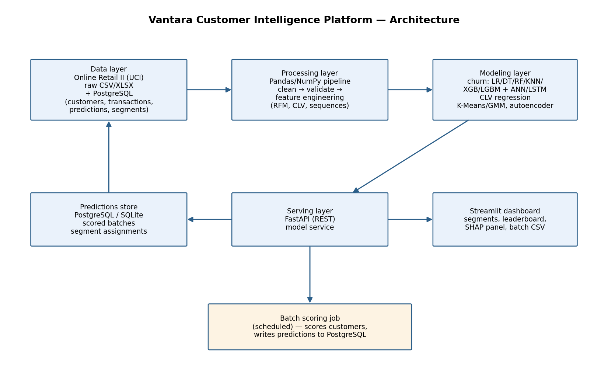
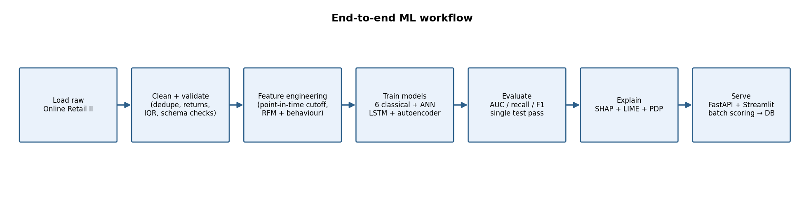

# Vantara Customer Intelligence Platform

A machine-learning platform that turns raw retail transactions into **churn
risk scores**, **customer lifetime value (CLV) estimates**, **next-purchase
behaviour predictions**, **customer segments**, and **plain-language
explanations** — served through a REST API and a business-facing Streamlit
dashboard.

Built end-to-end from the [Online Retail II dataset](https://archive.ics.uci.edu/dataset/502/online+retail+ii)
(UCI, CC BY 4.0): 1,067,371 invoice lines → 5,337 customers.

---

## 1. What it does

| Capability | Approach | Where |
|---|---|---|
| Churn prediction | LogReg, Decision Tree, Random Forest, KNN, XGBoost, LightGBM (+ ANN, LSTM) — compared in one table, best model served | `src/models/` |
| CLV estimation | LightGBM regression on log1p future 180-day revenue (repeat customers) | `src/models/train_clv.py` |
| Sequential behaviour | LSTM over time-ordered purchase-event sequences | `src/models/train_dl.py` |
| Anomaly detection | Autoencoder reconstruction error (top 5% flagged) | `src/models/train_dl.py` |
| Segmentation | K-Means (k chosen by silhouette) + GMM comparison + hierarchical sanity check, with business-readable profiles | `src/segmentation/` |
| Explainability | SHAP (global + force plots), LIME comparison, PDPs, plain-language "why flagged" template | `src/explainability/` |
| Serving | FastAPI (single + batch scoring, model card, health) + Streamlit dashboard | `api/`, `frontend/` |
| Persistence | PostgreSQL via SQLAlchemy (SQLite fallback locally) for predictions & segment assignments | `api/database.py` |

## 2. Architecture

Four layers — data → processing → modeling → serving — with scored
predictions written back to the database so the dashboard never recomputes:





## 3. Quickstart (local, no Docker)

```bash
# 1. Create a virtual environment and install dependencies
python -m venv .venv && source .venv/bin/activate   # Windows: .venv\Scripts\activate
pip install -r requirements.txt                    # torch CPU build first if needed:
                                                   # pip install torch --index-url https://download.pytorch.org/whl/cpu

# 2. Download the dataset (one command; ~43 MB from UCI)
python scripts/download_data.py

# 3. Run the full pipeline: clean → features → all models → segments → XAI
python -m src.pipeline --stage all                 # ~3–5 min on a laptop

# 4. Start the API and dashboard (two terminals)
uvicorn api.main:app --reload                      # http://localhost:8000  (/docs for Swagger)
streamlit run frontend/dashboard.py              # http://localhost:8501

# 5. Run the test suite
pytest tests/ -v
```

Pipeline stages can also be run individually:
`python -m src.pipeline --stage data|features|classical|clv|dl|segmentation|explainability`

## 4. Docker (single command)

```bash
docker-compose up --build
```

This starts PostgreSQL, the FastAPI service (port 8000) and the Streamlit
dashboard (port 8501). All configuration is via environment variables — see
`.env.example`.

> **Note on repository layout:** the working directory in this repo is the
> repository root itself; the PRD's illustrative folder name
> `customer-behavior-prediction/` was renamed to match the repo name
> (`Vantara-Customer-Intelligence-Platform`). All sub-paths follow the PRD
> structure exactly. (Written note per PRD Section 15.)

## 5. API endpoints

| Method | Path | Description |
|---|---|---|
| GET | `/health` | Liveness probe |
| GET | `/model-metadata` | Model card: features, comparison metrics, segments |
| POST | `/predict` | Single-customer score from a feature JSON map |
| GET | `/predict/{customer_id}` | Score an existing customer from the feature store |
| POST | `/predict/batch` | Batch scoring (CSV upload or JSON records); persists to DB |
| GET | `/explain/{customer_id}` | SHAP contributors + plain-language explanation |
| GET | `/segments` | Segment profiles with business-readable labels |

Interactive Swagger documentation is auto-generated at **`/docs`**.

## 6. Dashboard views

1. **Churn risk leaderboard** — high-value, high-risk customers first
2. **Segment explorer** — PCA customer map with segment / country / value-tier filters
3. **Revenue trends** — monthly revenue with a linear-trend forecast overlay
4. **Model comparison** — every model ranked by validation AUC / recall
5. **Customer explainability** — SHAP panel for any customer ID + global summary
6. **Batch scoring** — CSV upload with downloadable results

## 7. Churn definition & leakage discipline

* Snapshot date **2011-09-09**; features use transactions **strictly before** it.
* A customer **churns** if they have no order within **90 days** after the snapshot.
* **CLV target** = revenue in the **180 days** after the snapshot.
* Because features and targets come from disjoint time windows by
  construction, target leakage is prevented in code — and pinned by the
  leakage tests in `tests/test_features.py`.

## 8. Results (test set, seed 42)

Churn classifiers ranked by validation ROC-AUC (full table in
`models_artifacts/model_comparison.csv` after running the pipeline):

| Model | Val AUC | Test AUC | Notes |
|---|---|---|---|
| Random Forest | ~0.82 | ~0.81 | **production model** — best AUC/recall balance |
| XGBoost | ~0.81 | ~0.79 | strong second |
| Logistic Regression | ~0.80 | ~0.80 | best calibrated baseline |
| LightGBM | ~0.80 | ~0.78 | fast, similar to XGB |
| KNN | ~0.79 | ~0.77 | distance-based reference |
| Decision Tree | ~0.62 | ~0.62 | deliberately weak reference |
| ANN | — | ~0.80 | uncorrelated errors vs trees → retained as secondary check |
| LSTM | — | ~0.76 | higher recall (0.82) — best for "catch every at-risk" use |

Segmentation selects **k = 4** by silhouette score; profiles include
"Champions", "Promising regulars", "At-risk high-value" and "Hibernating"
segments with churn rates and median CLV per segment.

## 9. Mathematical foundations

The final report appendix (`docs/final_report.pdf`) covers the equations the
code actually uses: RFM quantiles and conditional purchase probability,
PCA/eigendecomposition of the covariance matrix, logistic regression with
binary cross-entropy, gradient descent & backpropagation (with the ANN/LSTM
loss curves in `models_artifacts/*_loss_curve.csv`), L1/L2 regularization
and dropout, and the precision/recall/F1/ROC-AUC metric definitions.

## 10. Repository structure

```
├── data/                  # raw / interim / processed (git-ignored)
├── notebooks/             # 01_eda, 02_feature_engineering, 03_model_experiments
├── src/
│   ├── data/              # loading, cleaning, validation
│   ├── features/          # leakage-safe RFM/CLV/sequence builders
│   ├── models/            # classical ML, CLV, PyTorch DL training
│   ├── segmentation/      # K-Means + GMM clustering & profiling
│   ├── explainability/    # SHAP / LIME / PDP wrappers
│   └── utils/             # config loader, logging
├── api/                   # FastAPI app, schemas, DB layer, scoring service
├── frontend/              # Streamlit dashboard
├── models_artifacts/      # trained models, metrics, XAI outputs (git-ignored)
├── config/config.yaml     # every path, hyperparameter, threshold
├── tests/                 # leakage tests + API integration tests
├── docs/                  # architecture / ER / workflow diagrams + final report
├── scripts/               # data download, diagram & notebook generators
├── docker-compose.yml
├── Dockerfile
└── requirements.txt
```

## 11. Dataset & license

Chen, D. (2012). Online Retail II [Dataset]. UCI Machine Learning Repository.
https://doi.org/10.24432/C5CG7D — CC BY 4.0. Download: `scripts/download_data.py`.

## 12. Limitations & future work (PRD Section 4.2)

* Transformer-based sequence models — documented future enhancement.
* Real-time streaming ingestion (Kafka) — batch scoring only in this phase.
* Multi-tenant auth / RBAC / production CI-CD — future hardening.
* A/B testing framework for measuring campaign impact of model scores.
* CLV R² is modest (~0.22) — retail future revenue is dominated by stochastic
  timing; recommendations for improvement are in the final report.
